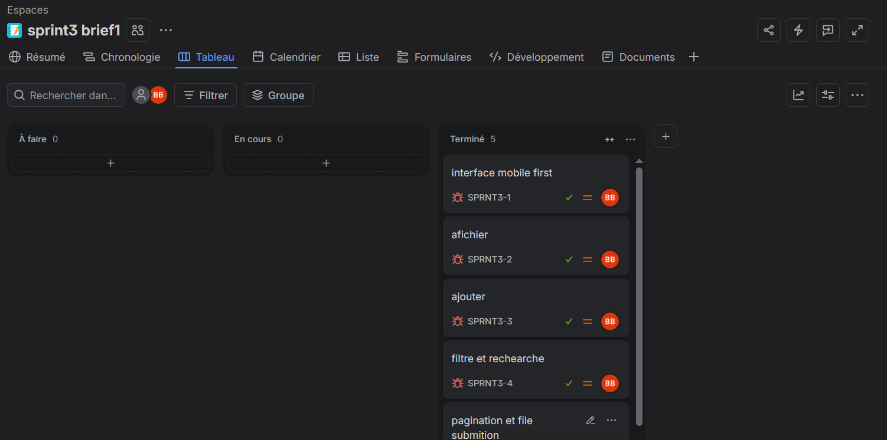

# 🎬 Sériescope

Catalogue de séries TV pour explorer, rechercher et enrichir une bibliothèque de séries.

🔗 **Démo en ligne :** [brahim-boukrim.github.io/seriescope-](https://brahim-boukrim.github.io/seriescope-/)

---

## 📋 Planning Jira



---

## À propos

Sériescope affiche une liste de séries récupérées depuis l'API TVMaze. Tu peux chercher une série par son nom, filtrer par genre, afficher plus de séries à la demande et ajouter tes propres séries au catalogue. Le site est conçu **mobile first** et s'adapte aux écrans plus grands.

## Fonctionnalités

- **Interface mobile first** : une colonne sur mobile, trois colonnes sur desktop.
- **Affichage des séries** : chaque carte montre l'affiche, le nom, les genres (badges) et un résumé.
- **Ajout d'une série** via un formulaire : nom, genre(s) séparés par des virgules, description facultative et photo.
- **Validation du formulaire** : les champs obligatoires (nom, genres) doivent être remplis, sinon un message d'erreur s'affiche.
- **Sauvegarde locale** : les séries ajoutées sont enregistrées dans le `localStorage` et restent après un rechargement.
- **Recherche** par nom, en temps réel.
- **Filtre par genre** : la liste des genres se remplit avec les séries affichées.
- **Pagination** : le bouton « show more » affiche 10 séries de plus, et le compteur indique le nombre de séries affichées.

## Technologies

| Outil | Usage |
|---|---|
| HTML5 | Structure de la page |
| [Tailwind CSS](https://tailwindcss.com/) | Mise en forme (CSS compilé dans `dist/output.css`) |
| JavaScript (vanilla) | Logique de l'application (DOM, `fetch`, `localStorage`) |
| [API TVMaze](https://www.tvmaze.com/api) | Source des données des séries |
| [Font Awesome](https://fontawesome.com/) | Icônes |

## Structure du projet

```
seriescope-/
├── src/                  # Fichiers sources Tailwind
├── dist/
│   └── output.css        # CSS Tailwind compilé
├── index.html            # Page principale
├── index.js              # Logique : affichage, ajout, filtre, recherche, pagination
├── tailwind.config.js    # Configuration Tailwind
├── package.json
└── package-lock.json
```

## Installation

1. Cloner le dépôt :

   ```bash
   git clone https://github.com/brahim-boukrim/seriescope-.git
   cd seriescope-
   ```

2. Installer les dépendances :

   ```bash
   npm install
   ```

3. Ouvrir `index.html` dans le navigateur, ou lancer un serveur local (par exemple avec l'extension **Live Server** de VS Code).

Une connexion internet est nécessaire pour charger les séries depuis l'API TVMaze et les icônes Font Awesome.

## Utilisation

**Ajouter une série**

1. Remplir le **nom** et le ou les **genres** (séparés par des virgules, par exemple `Drame, Comédie`).
2. Ajouter une description et une photo si tu veux.
3. Cliquer sur **Ajouter la série**. Elle apparaît en premier dans le catalogue.

**Rechercher et filtrer**

- Taper dans le champ **Recherche** pour filtrer par nom.
- Choisir un **Genre** dans la liste déroulante pour ne voir que ce genre. Les deux filtres fonctionnent ensemble.

**Afficher plus**

- Cliquer sur **show more** pour charger 10 séries de plus.

## Source des données

Les séries viennent de l'API publique [TVMaze](https://www.tvmaze.com/api) (`https://api.tvmaze.com/shows?page=0`).

## Auteur

Projet réalisé par [brahim-boukrim](https://github.com/brahim-boukrim) dans le cadre du Sprint 3 – Brief 1.